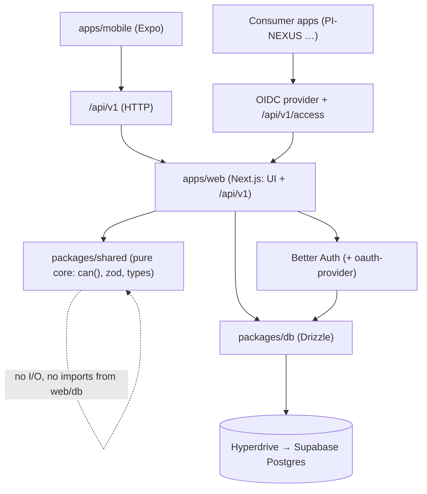
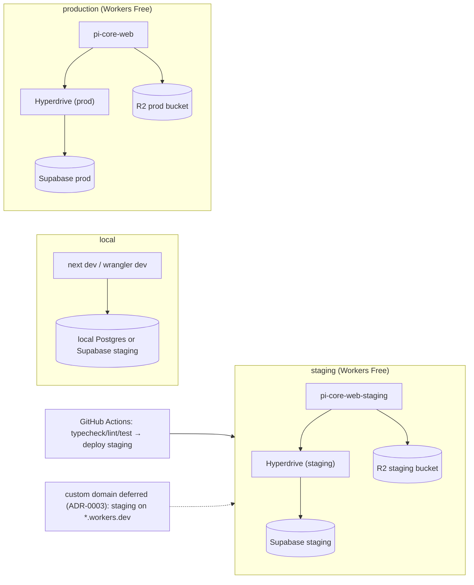
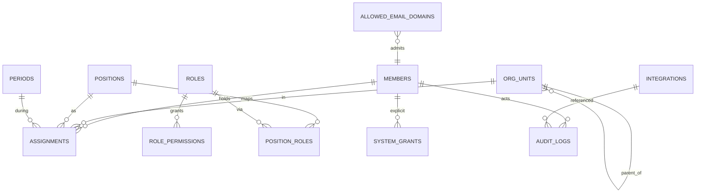

# Architecture Spine — PI-CORE

## Design Paradigm

Layered with a **pure core**. One process (a Next.js app on Cloudflare Workers via OpenNext) serves both the admin web UI and the `/api/v1` HTTP API; the Expo app is a separate client of the same API.

- **Pure core** — `packages/shared`: `can()` authorization, permission/role constants, zod schemas, API types. **No I/O.** The only place authorization logic exists.
- **Adapters** — `packages/db` (Drizzle over Hyperdrive → Postgres), and the auth adapter (Better Auth). Both are replaceable behind the core's types.
- **Edge (delivery)** — `apps/web` route handlers (API) + App Router (UI); `apps/mobile` Expo client. Delivery never contains business rules; it validates, calls the core, and maps to HTTP.

## Inherited Invariants

None — this is the top-level spine. (`AGENTS.md` and `docs/SECURITY.md` are binding standing rules, carried as AD-2/AD-4/AD-12/AD-15.)

## Invariants & Rules

### AD-1 — One Postgres, reached only through Hyperdrive
- **Binds:** all
- **Prevents:** a client or a second writer talking to the database directly, and split connection/pooling behaviour.
- **Rule:** The only datastore is the Supabase PostgreSQL instance. All access goes through the `HYPERDRIVE` binding from Worker code. No Supabase client libraries, no direct `DATABASE_URL` in the Worker (it is used only by `drizzle-kit` for migrations). Hyperdrive connects with Supabase's **direct** connection string (Hyperdrive does the pooling).

### AD-2 — One authorization function, pure, deny-by-default
- **Binds:** FR-25, FR-26, FR-27, FR-28; all endpoints
- **Prevents:** two endpoints disagreeing about who may do what; UI-hiding mistaken for enforcement.
- **Rule:** `can(actor, permission, target?)` lives in `packages/shared`, is pure and unit-tested, and is called by **every** route handler before touching data. Unlisted permission ⇒ denied. A test fails if a route lacks the check.

### AD-3 — Scope is enforced in the query
- **Binds:** FR-8, FR-29, all list/read endpoints
- **Prevents:** fetching rows then filtering in JS (leaks + cost).
- **Rule:** `U` scope filters by the actor's unit subtree **in SQL**; `O` is org-wide; `S` is self-only. Never post-filter.

### AD-4 — Validate at the boundary with shared zod schemas
- **Binds:** FR-52; all endpoints
- **Prevents:** drifting request/response shapes between web, mobile and consumers.
- **Rule:** Every input is parsed by a zod schema from `packages/shared`; unknown fields on writes are rejected; queries are parameterized (Drizzle) only.

### AD-5 — One error envelope and a propagated `requestId`
- **Binds:** FR-51; all endpoints
- **Prevents:** each surface inventing its own error shape; un-correlatable logs.
- **Rule:** Errors are `{ error: { code, message, details?, requestId } }`. `requestId` is generated per request and propagated to structured logs and `audit_logs`.

### AD-6 — Auth is Better Auth; PI-CORE is its own OIDC provider
- **Binds:** FR-1..FR-7, FR-34..FR-39
- **Prevents:** hand-rolled token/ID-token logic; two auth implementations (web vs mobile vs consumers).
- **Rule:** Google sign-in and sessions come from **Better Auth** (`better-auth`, Google provider). The OIDC provider for consumers is **`@better-auth/oauth-provider`** (the old `oidcProvider` in `better-auth/plugins` is removed). Consumers get a small ID token (`sub`, `email`, `name`) and fetch authorization from `GET /api/v1/access`; they never trust client-supplied roles.

### AD-7 — Session model is fixed per surface
- **Binds:** FR-5, FR-2
- **Prevents:** a mobile token ending up in a cookie or vice-versa; non-revocable sessions.
- **Rule:** Web = httpOnly + Secure + SameSite cookie. Mobile = tokens in `expo-secure-store`, system-browser OAuth (Authorization Code + PKCE, `expo-auth-session`). Refresh tokens rotate. Deactivation or role removal revokes sessions/tokens promptly.

### AD-8 — Access derives from the active period only
- **Binds:** FR-20, FR-21, FR-31; AD-2
- **Prevents:** a past/future assignment granting access; two "current" states.
- **Rule:** Effective roles = union of `position_roles` for assignments in the **single active period** + explicit `system_grants` + implicit `anggota`. At most one period is active (partial unique index); activation is one audited transaction.

### AD-9 — Audit log is append-only and complete
- **Binds:** FR-43, FR-44; all mutations
- **Prevents:** silent privilege changes; un-reconstructable history.
- **Rule:** Every mutation of members/assignments/periods/roles/integrations/settings writes one `audit_logs` row (actor, action, entity, redacted before/after, ip, user_agent, request_id). The table has no UPDATE/DELETE grants.

### AD-10 — R2 is private; avatars via signed access
- **Binds:** FR-14, FR-41
- **Prevents:** public object URLs; guessable keys; unbounded uploads.
- **Rule:** The bucket is private. Avatars/logo are served through an authorized route or short-lived presigned GET; uploads use presigned PUT (validate type/size, strip metadata, random key namespaced by member id). `r2.dev` is never a production URL.

### AD-11 — Fit the Workers **Free** envelope, and watch it
- **Binds:** all; NFR-17
- **Prevents:** shipping a design that silently 1102s (CPU) or 1027s (daily requests) on the free plan.
- **Rule:** Workers **Free** is the ceiling (no paid plan). Runtime = Next.js **Node.js** runtime with `nodejs_compat`. Budget: **10 ms CPU/request**, 128 MB memory, **3 MiB** compressed Worker, 100k requests/day, 50 subrequests/request, 6 concurrent outbound connections. Keep route handlers thin (no heavy SSR/serialization on hot paths); measure CPU and bundle in Phase 0 and report — do **not** upgrade without owner approval. *Known risk: the 10 ms CPU budget is below what auth + SSR typically cost (Cloudflare: "10–20 ms"); see ADR-0008.* Mitigation order (**ADR-0010**): (1) **static-first UI** — navigation served from static assets without invoking the Worker — plus thin API handlers; (2) if still over budget, **split the API into a lean Hono Worker** (Service bindings); (3) only then seek paid-plan approval.

### AD-12 — Secrets never enter the repo, the bundle, or logs
- **Binds:** all
- **Prevents:** credential leakage; per-environment drift.
- **Rule:** Secrets live in `wrangler secret` / EAS secrets / GitHub secrets, one set per environment. Commit `.env.example` only. No token, cookie or sensitive field is ever logged.

### AD-13 — Schema changes are forward-only SQL migrations with RLS on
- **Binds:** all data
- **Prevents:** ad-hoc schema drift; a table exposed without RLS.
- **Rule:** Schema is defined in Drizzle (`packages/db`); migrations are SQL, reviewed, forward-only, and apply cleanly on an empty DB and on current state. Every table has RLS enabled with **no** public policies; the Supabase Data API is disabled (Postgres used directly).

### AD-14 — The consumer contract is OIDC + `/api/v1/access`
- **Binds:** FR-34..FR-39; consumers (PI-NEXUS, …)
- **Prevents:** consumers re-implementing roles or trusting stale claims.
- **Rule:** Consumers integrate only through the OIDC provider (Authorization Code + PKCE, exact-match redirect URIs, discovery, JWKS) plus `GET /api/v1/access` (Bearer access token) returning active period, assignments, roles and permission keys. No shared cross-subdomain cookies.

### AD-15 — Personal data is minimized and guarded
- **Binds:** FR-9, FR-13; NFR-6
- **Prevents:** sensitive fields leaking to unauthorized actors or into logs.
- **Rule:** NIM/phone/email are returned only to holders of `member:read_sensitive`; redacted in logs and audit before/after; members are soft-deleted; an anonymization path exists.

### AD-16 — Real-time updates flow through one hub
- **Binds:** FR-55, FR-56, FR-57; all mutations
- **Prevents:** each screen polling or inventing its own live path; a push channel that leaks data beyond a client's scope.
- **Rule:** A single **`RealtimeHub` Durable Object** (SQLite-backed, WebSocket **Hibernation API**) fans out domain events. Every mutation publishes a minimal event (`{ topic, entity, id, action, at }`) to the hub. The channel is a **notification** channel: events carry ids/action only and clients re-fetch through the authorized `/api/v1` API, so scope is always enforced by `can()` in the query; subscriptions are authorized at connect time. **SSE** is the fallback transport. Durable Objects run on Workers Free (SQLite-backed classes only) and DO requests count toward the 100k/day limit (ADR-0011).

### Dependency direction



## Consistency Conventions

| Concern | Convention |
| --- | --- |
| Naming | DB snake_case; TS camelCase; ids UUIDv7 (ordered) unless a table needs a natural key; tables plural. |
| Data & formats | Dates ISO-8601 UTC in transport; `citext` for email; soft delete via `deleted_at`; money none. |
| Errors | `{ error: { code, message, details?, requestId } }`; codes are stable, machine-readable. |
| Pagination | Cursor-based (`?cursor=&limit=`), never offset. |
| State & mutation | Mutations go through route handlers → core check → Drizzle; each writes an audit row (AD-9). |
| Config | Per-environment bindings/vars via Wrangler; no env branching inside business logic. |
| Logging | Structured JSON with `requestId`; never log secrets/tokens/sensitive fields. |
| Time & auth | Server is the only clock/authority; clients never assert roles (AD-6). |

## Stack

| Name | Version | Notes (verified 2026-10-15) |
| --- | --- | --- |
| Node.js | ≥ 20 (dev: 26.7.0) | BMAD requires 20+ |
| pnpm / Turborepo | 10.20.0 | monorepo tooling |
| TypeScript | strict | everywhere |
| Next.js | **16** (App Router) | supported by the adapter (14 dropped Q1 2026) |
| @opennextjs/cloudflare | latest | Node.js runtime; needs `nodejs_compat`; 3 MiB Free worker |
| Cloudflare Workers | Free plan | 10 ms CPU/req · 100k req/day · 128 MB · 50 subreq |
| Cloudflare Hyperdrive | — | included on all plans; Supabase **direct** connection |
| Cloudflare R2 | — | private bucket; presigned URLs (≤7 days) |
| Cloudflare Durable Objects | Free (SQLite-backed) | real-time hub; WebSocket Hibernation = zero idle cost (ADR-0011) |
| PostgreSQL (Supabase) | — | Data API disabled; RLS on all tables |
| Drizzle ORM + drizzle-kit | ≥ 0.26.2 (`drizzle-orm/node-postgres`) | driver `pg` ≥ 8.13.0 |
| Better Auth | **1.6.x** (latest stable) | Google provider; Expo plugin |
| @better-auth/oauth-provider | latest | OIDC provider (replaces removed `oidcProvider`) |
| zod | latest | shared schemas |
| Expo SDK | **57** | expo-router, expo-auth-session 57, expo-secure-store 57, expo-crypto |
| Tailwind + shadcn/ui | latest | web UI per `docs/DESIGN.md` tokens |

## Structural Seed

```text
pi-core/
  apps/
    web/        # Next.js App Router: admin UI + /api/v1 route handlers
    mobile/     # Expo Router app
  packages/
    shared/     # pure core: can(), permissions, zod schemas, types
    db/         # Drizzle schema + SQL migrations + seeds
    config/     # shared tsconfig / eslint / prettier
  docs/         # authoritative kit docs (ARCHITECTURE, SECURITY, DESIGN, ROADMAP, STATE, decisions/)
  _bmad-output/ # BMAD planning artifacts
```

### Deployment & environments



### Core entities (names + relationships)



## Capability → Architecture Map

| Capability / Area | Lives in | Governed by |
| --- | --- | --- |
| Auth & sessions (Google) | Better Auth adapter | AD-6, AD-7 |
| Member directory | `apps/web` + `packages/db` | AD-2, AD-3, AD-15 |
| Org units | `packages/db` | AD-1, AD-13 |
| Periods | `packages/db` | AD-8, AD-9 |
| Roles & permissions | `packages/shared` (`can()`) | AD-2, AD-3 |
| Assignments | `apps/web` + `packages/db` | AD-2, AD-8 |
| Integrations & OIDC | Better Auth `oauth-provider` | AD-6, AD-14 |
| Settings / auth config | `apps/web` | AD-2, AD-9 |
| Audit log | `packages/db` | AD-9, AD-5 |
| Admin website | `apps/web` | AD-11, `docs/DESIGN.md` |
| Mobile app | `apps/mobile` | AD-7, AD-11 |
| HTTP API | `apps/web/api/v1` | AD-4, AD-5 |
| Real-time updates | `RealtimeHub` Durable Object + web/mobile subscribers | AD-16, AD-11 |

## Deferred

- **Rate-limiting binding choice** (Workers Rate Limiting vs KV) — decide in Phase 3 with the first write endpoints; both fit AD-11.
- **RLS-with-wire-claims nuance** — with the Data API disabled, RLS policies keyed on `auth.uid()` need a per-request claims GUC; decide in Phase 1 whether RLS is the primary row guard or defense-in-depth behind `can()`. (Postgres RLS still applies to the connecting role regardless.)
- **R2 access mechanism** — presigned URLs vs the Worker binding (`getCloudflareContext()` under OpenNext); decide in Phase 1 with avatar upload.
- **Optional admin TOTP step-up** — Phase 6 (OQ-9).
- **Reports / Events / Notifications / Panitia** — deferred features (ROADMAP).
- **iOS distribution** — dev-only target (ADR-0004); distribution deferred.
- **Custom domain** — deferred (ADR-0003); staging on `*.workers.dev`.
- **Per-story detail** (exact endpoint shapes, table columns) — owned by the code and stories, not this spine.
